

____
## О себе
Меня зовут Даша, мне 18 лет, учусь в РГУ им. А.Н. Косыгина на направлении "Графический дизайн". Активно развиваю навыки работы в графических редакторах. Уверенно работаю в программах Adobe Photoshop и Illustrator, также Affinity и CorelDRAW. На базовом уровне разбираюсь в Adobe After effects и Adobe InDesign и Figma. Также есть опыт использования нейросетей (open AI) и небольшой опыт работы графическим дизайнером (инфографика, создание дизайнов для различных канцелярии и печатной продукции). Рисую большую часть своей жизни, 6 лет занималась в художественной студии, в будущем мечтаю работать в сфере графического дизайна. Ниже будут представлены некоторые из моих работ.

***
### Освоенные программы:
* [Krita](#Krita)
* [Affinity](#Affinity)
* [Photoshop](#Photoshop)
* [Illustrator](#Illustrator)
* [coralDRAW](#coralDRAW)
* [After effects](#Aftereffects)
* Figma
* Skechup
* InDesign

***

### **Соцсети:**

* [телеграм](https://t.me/gokomyyy)
* [вконтакте](http://vk.com/gokomyyy)
* [email](dariadak1990@gmail.com)

# $$\color{red} Примеры \space работ $$
___
## Krita
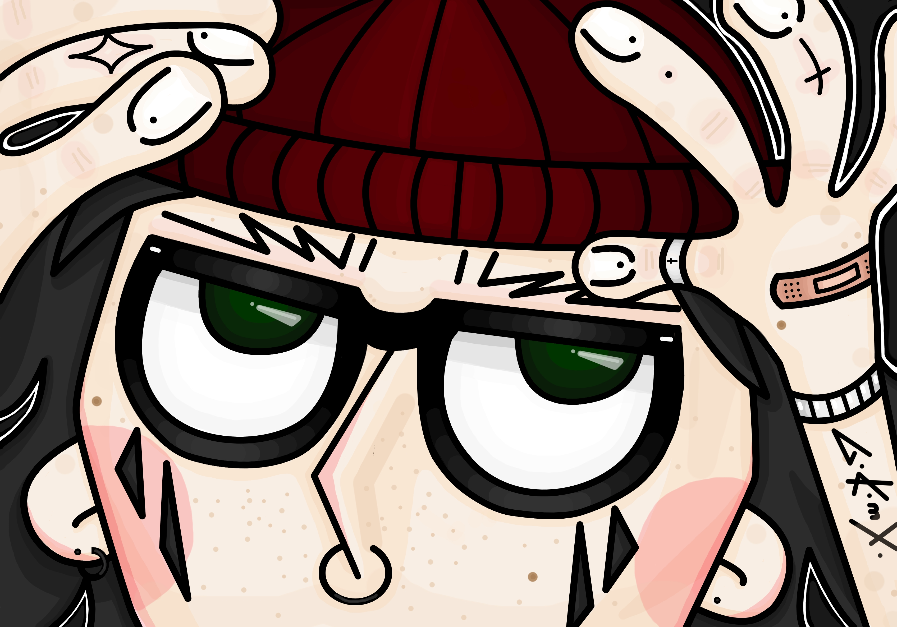

___
## Affinity
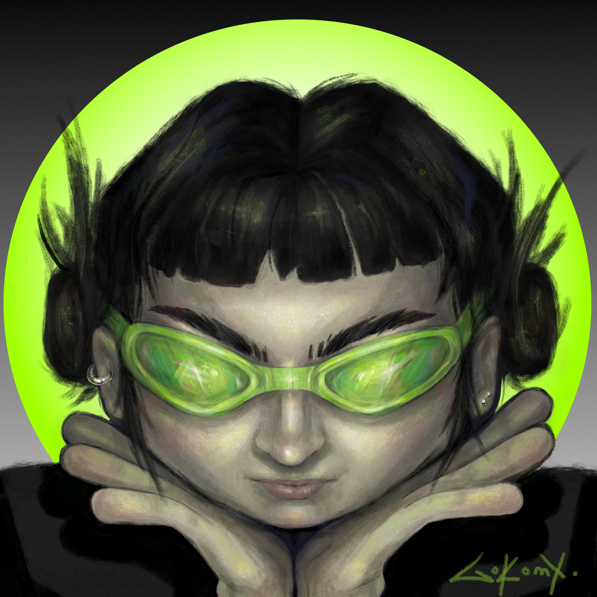
___
## Illustrator
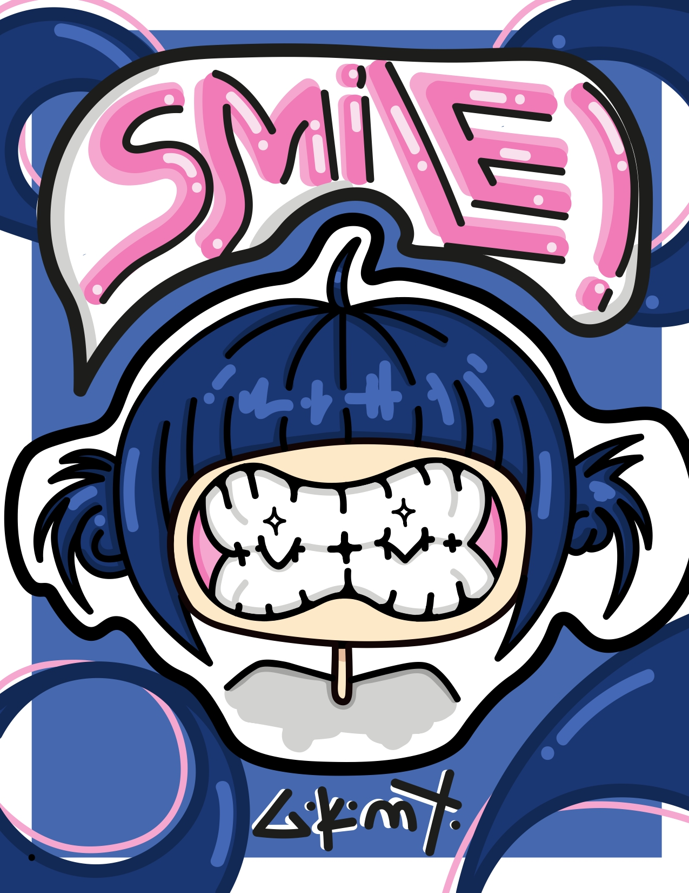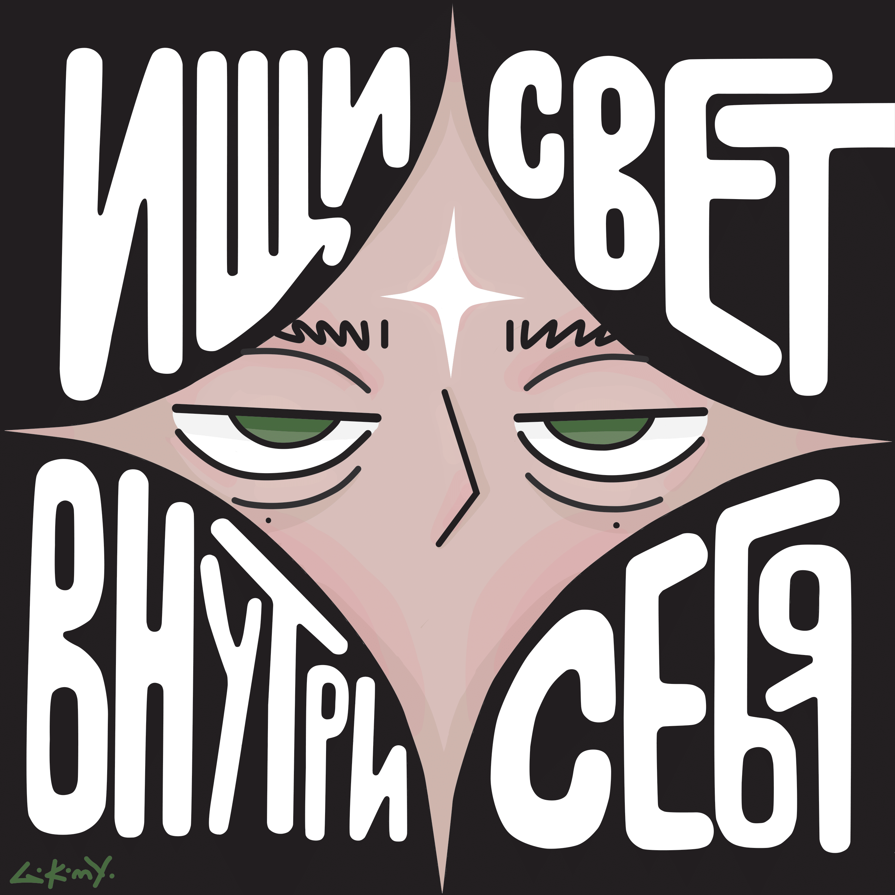
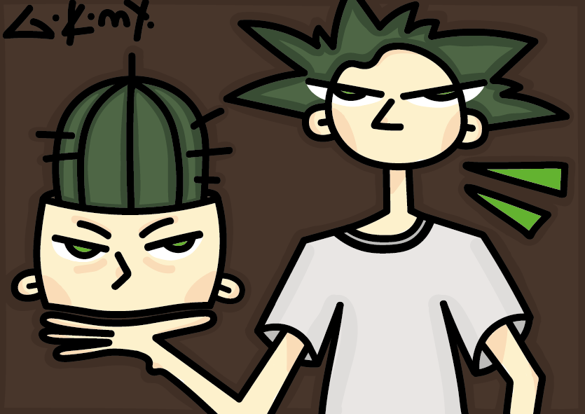 
# - $$\color{blue} различные \space иллюстрации. $$

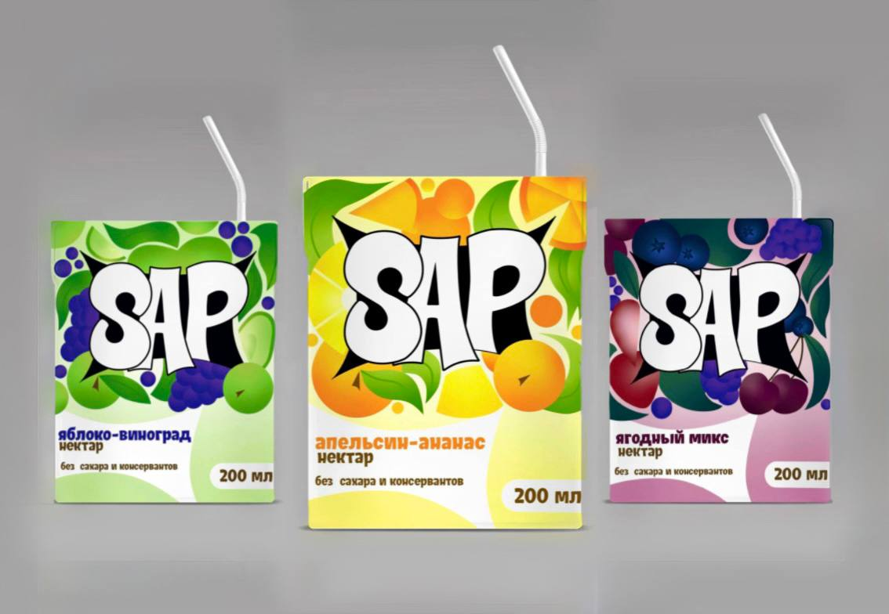
# - $$\color{blue} упаковки \space сока, \space нарисованны \space в \space illustrator, \space мокап \space сделан \space в \space программе \space photoshop. $$
___
## Photoshop

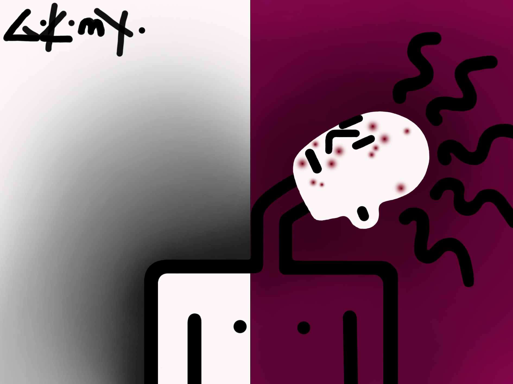
___
## coralDRAW
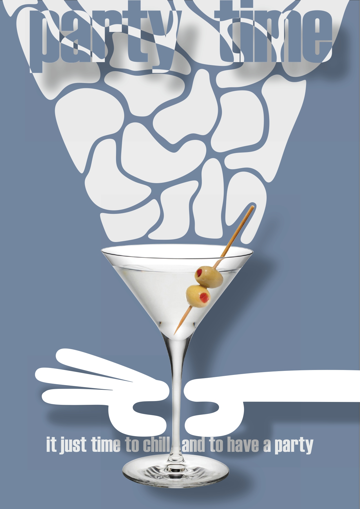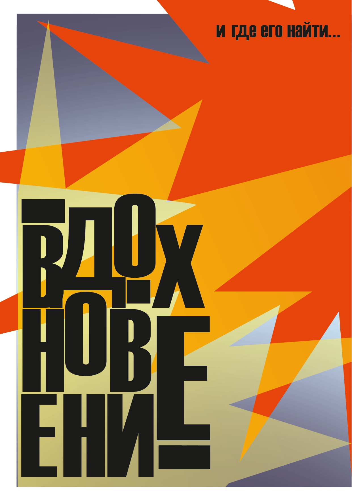

___
## After effects
 

# - $$\color{blue}  Набор анимированных стикеров в телеграме. Нарисованны в Illustrator, анимированны при помощи нейросетей open ai. $$

___
___
# Скетчиии :)
 
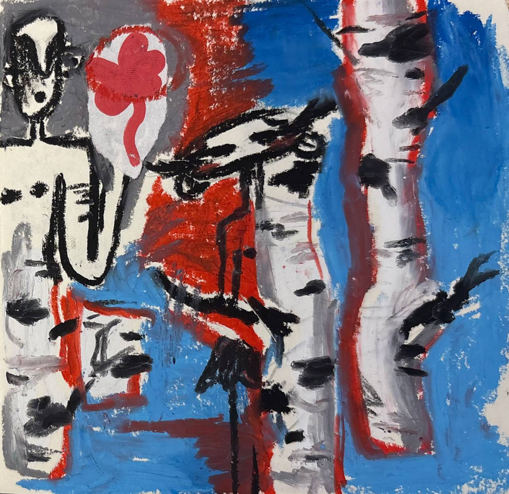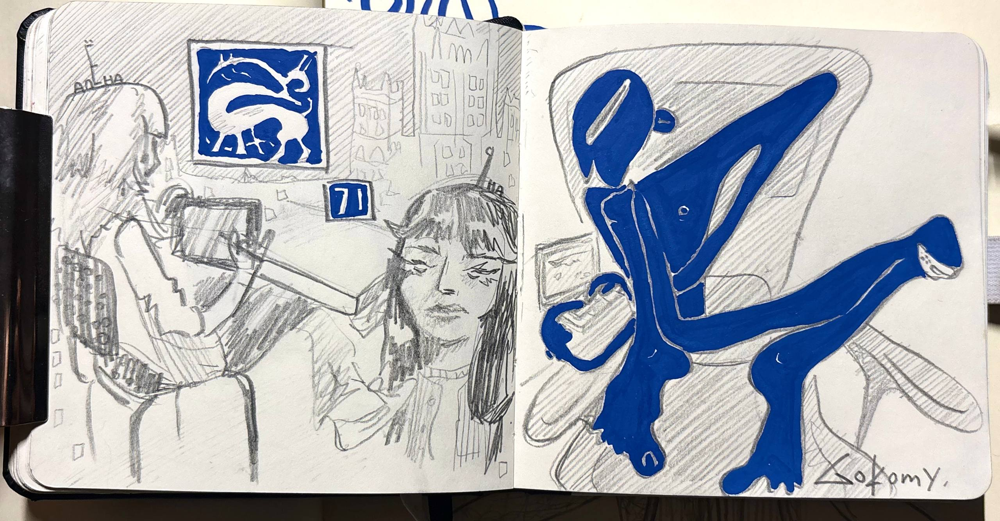

